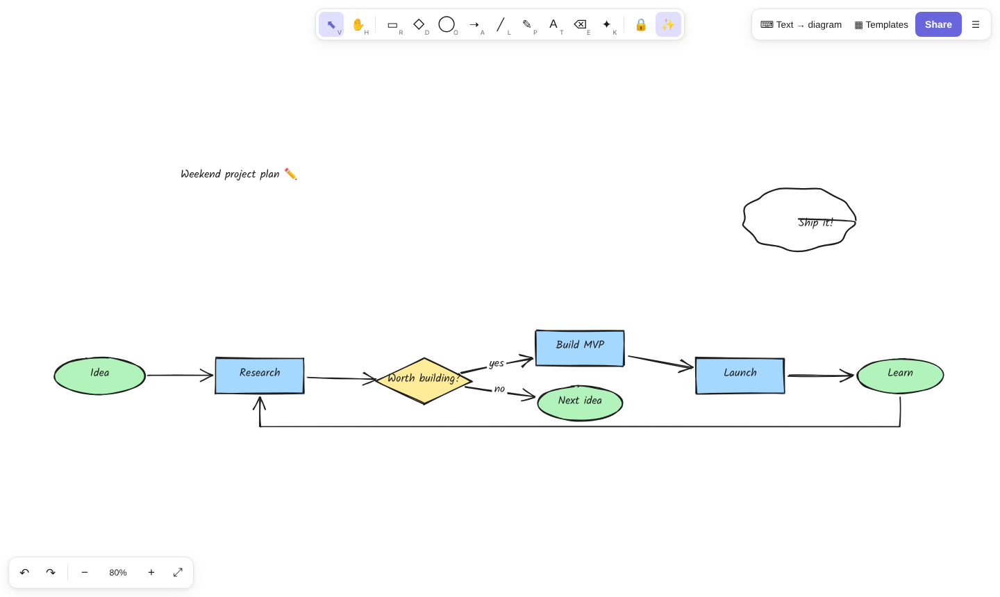

<div align="center">

# ✏️ Sketchwise

### A hand-drawn whiteboard that turns scribbles and plain text into clean diagrams.

Sketch boxes, arrows and notes that look hand-drawn, **type a flowchart and watch it draw itself**, and let **ink-to-shape** tidy up your pen strokes. Runs entirely in your browser: no account, no server, nothing to install.

**[▶ Open Sketchwise](https://mnbresearch.github.io/sketchwise/)** · [Features](#-features) · [Text → diagram](#-text--diagram) · [Shortcuts](#-shortcuts) · [Use cases](#-use-cases)



</div>

---

## ✨ Features

**Drawing**
- Rectangles, diamonds, ellipses, arrows, lines, freehand pen, text and images, all in a sketchy [rough.js](https://roughjs.com) style
- **Smart arrows**: drop an arrow's end on a shape and it stays connected as you move the shape; loop-back edges route around the diagram
- **Labels in shapes**: double-click any shape or arrow to write inside it
- Style controls: stroke and fill colours, hachure / cross-hatch / solid fill, stroke width, sloppiness (architect → cartoon), font size, opacity
- Select, multi-select, marquee, move, resize, Alt-drag to duplicate, layer order, arrow-key nudge, grid snap
- Infinite canvas with pan, wheel and pinch zoom, and zoom-to-fit

**Features beyond a plain whiteboard**
- ⌨️ **Text → diagram**: write `Idea -> Research -> {Worth it?}` and get a laid-out, editable flowchart with diamonds, rounded nodes, labelled edges and cycles. An indented list becomes a **mind map**. Pasting text that contains `->` onto the canvas does the same.
- ✨ **Ink → shape**: rough circles, boxes, diamonds and lines drawn with the pen snap into clean shapes. You can toggle it on and off.
- ▦ **Templates**: Kanban, SWOT, retrospective, user signup flow, system architecture and mind map.
- ✦ **Laser pointer** for presenting and screen-sharing.
- 🔗 **Share links**: the whole board is compressed into the URL, so no server ever sees it.
- 🔄 **Live multi-tab sync**: open the board in two tabs and edits appear in both.
- 💾 **Autosave**, **.sketchwise** files, drag-and-drop or paste images, export to **PNG / SVG** or copy the PNG to the clipboard. If something is selected, only the selection is exported.
- 🌙 Dark mode, touch and pen support, works on phones.

Inspired by [Excalidraw](https://github.com/excalidraw/excalidraw) (MIT). Sketchwise is an independent, from-scratch implementation in about 1.6k lines of vanilla JS; no code was copied. It focuses on **diagram-from-text** and **ink cleanup**.

## ⌨️ Text → diagram

```text
(Idea) -> Research -> {Worth building?}
{Worth building?} -[yes]-> Build MVP -> Launch -> (Learn)
{Worth building?} -[no]-> (Next idea)
Learn -> Research
```

| Syntax | Meaning |
|---|---|
| `A -> B -> C` | chain of arrows (also `-->`, `=>`, `→`) |
| `{Decision?}` | diamond |
| `(Start)` | rounded / ellipse |
| `[Step]` or `Step` | rectangle |
| `A -[label]-> B` | labelled edge |
| indented lines, no arrows | mind map |
| `# comment` | ignored |

The layout is layered left-to-right, with cycle detection and barycentre ordering to reduce crossings. Every node is a normal shape you can move, restyle and relabel.

## 🎹 Shortcuts

| Key | Action |
|---|---|
| `V` `H` | select · pan (or hold Space / middle-drag) |
| `R` `D` `O` `A` `L` `P` `T` | rectangle · diamond · ellipse · arrow · line · pen · text |
| `E` `K` `Q` | eraser · laser · keep tool active |
| `Shift` while drawing | square, circle, 15° angles |
| `Ctrl+Z` / `Ctrl+Shift+Z` | undo / redo |
| `Ctrl+D` · `Ctrl+C/V` · `Del` | duplicate · copy/paste · delete |
| `[` `]` | send back · bring front |
| `Ctrl+wheel`, pinch · `Shift+1` | zoom · zoom to fit |
| `Ctrl+S` | save .sketchwise |

## 🧭 Use cases

- **Engineers**: sketch system architecture in seconds from text, then export an SVG for the design doc or PR.
- **Product managers**: user flows and decision trees from a bullet list, with Kanban and retro templates for rituals.
- **Teachers and students**: mind maps from lecture notes; draw freely with a stylus while ink-to-shape keeps it legible.
- **Founders**: whiteboard a pitch or roadmap and send a share link that needs no sign-up.
- **Presenters and streamers**: laser pointer plus a hand-drawn look for live explanations.
- **Docs and blogs**: consistent sketchy diagrams exported as PNG or SVG.

## 🧱 Architecture

```
index.html, style.css      UI shell
sketch.js                  canvas renderer, tools, selection, editing, export, share, sync
lib/geometry.mjs           hit-testing, edge points, ink→shape recogniser, text→diagram parser + layout, URL compression (tested)
lib/templates.mjs          templates and diagram → elements
tests/                     node --test
```

Run locally with any static server, for example `python3 -m http.server`, then open http://localhost:8000. Run `npm test` for the tests.

## License

[MIT](LICENSE) © 2026 Mridul Nanda · [MNB Research](https://github.com/mnbresearch) · Abrobot.ai. rough.js is MIT © Preet Shihn.
